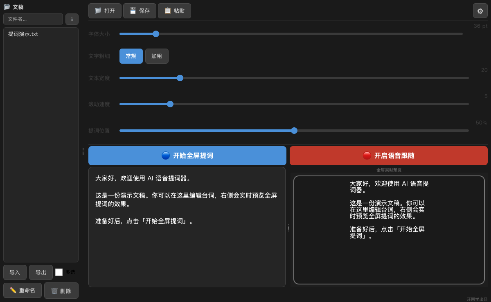

# 汪同学的 AI 语音提词器

一款面向 macOS 和 Windows 的离线 AI 语音提词工具。支持全屏提词、语音跟随、自由换行与段落保留、触控板快速定位，以及 TXT、Word、RTF、ODT 文稿的批量管理。

## 软件界面

左侧管理文稿，中间编辑台词，右侧实时预览提词效果。



## 主要功能

- Vosk 中文离线语音识别，无需上传稿件或录音
- 全屏平滑滚动、语音跟随和手动定位
- 保留原文换行、空段及段落结构
- 文稿批量导入、导出、重命名和删除
- macOS 触控板双指上下滑动
- macOS 与 Windows 64 位便携版打包配置

## 软件更新

在设置页打开“启动时自动检查更新”，或点击“立即检查更新”。发现新版本后，可选择下载并重启安装。

正式发布使用 `v主版本.次版本.修订号` 标签，并上传对应平台的 ZIP，例如 `ai-voice-teleprompter-v1.0.1-macos-arm64.zip` 和 `ai-voice-teleprompter-v1.0.1-windows-x64.zip`。ZIP 顶层应为完整的 `.app` 或 Windows 便携目录。应用从项目的公开 GitHub Releases 检查版本和校验值。

## 本地运行

需要 Python 3.12。

```bash
python3.12 -m venv venv312
source venv312/bin/activate
pip install -r requirements.txt
python src/main.py
```

Windows 激活虚拟环境时使用：

```bat
venv312\Scripts\activate
python src\main.py
```

## 语音模型

将 Vosk 中文小模型 `vosk-model-small-cn-0.22` 解压到：

```text
models/vosk-model-small-cn-0.22/
```

模型文件较大，不提交到 GitHub。可从 [Vosk 官方模型页面](https://alphacephei.com/vosk/models) 下载。

## 打包

macOS：

```bash
source venv312/bin/activate
pyinstaller --noconfirm --clean AI语音提词器.spec
```

Windows 64 位免安装版：

```bat
build_windows_portable.bat
```

## 作者

汪同学

## 支持作者

软件设置页底部提供“请作者喝一杯咖啡”入口，点击后可使用支付宝或微信自愿打赏，感谢支持。
